# Axiarix – User Guide & Workflow Tutorial

16 November 2026 · exported from the Claude Docs version of this guide

## Overview

Axiarix is a web app that runs an ISO/IEC 27001:2022 internal-audit programme end to end: checklists, assessments, evidence, auditor review, findings, corrective actions, approval and the final PDF report. Every step is role-controlled, branch-scoped and recorded in a tamper-evident audit trail.

The software supports a hospital's ISMS process. It does not by itself establish ISO/IEC 27001 conformity or certify anyone.

This guide covers the version running locally on 16 November 2026, including the governance features added that day: several organisations per installation, branch-scoped administrators, per-user permission restrictions, separation of duties, fixed financial-year periods and filters kept in the page link.

### The organisations in this demo

| Organisation | What it is | Who signs in |
| --- | --- | --- |
| Axiarix Platform | Internal organisation that holds the platform owner. No audit data. | `platform@axiarix.local` |
| Kauvery Hospitals Group | The pilot hospital. Branches Vadapalani (KVP) and Alwarpet (demo branch, KAL-DEMO). Real checklist workbook imported. | 7 demo accounts `@axiarix.local` |
| Sunrise Care Hospitals (Sample) | A fictitious organisation created from `sample-org/` with the new-organisation wizard. 3 branches, 5 departments, 14 users. | 14 accounts `@sunrise-sample.example.org` |

A fourth organisation, **Meridian Diagnostics (Sample)** (2 branches, 4 departments, 9 users), was created with the wizard on 16 November 2026. Its logins are in *Onboarding run: Meridian Diagnostics (Sample)* below, and the recordings are in `docs/demo/meridian-create-organisation.gif` and `docs/demo/meridian-admin-accepts-invite-and-signs-in.gif`.

All people, e-mails and the Sunrise organisation are fictitious. The `example.org` domain is reserved, so no real mailbox receives invitations.

## Getting started

Open http://localhost:5174 and sign in with one of the accounts below. All Kauvery accounts and the platform owner use the password `Axiarix@Dev2026` (development only).

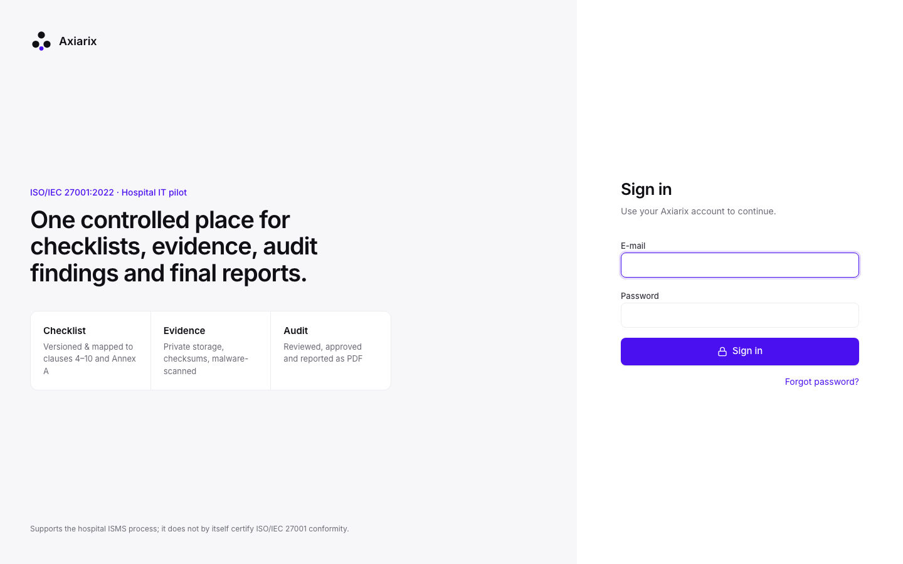

| Address | URL |
| --- | --- |
| Web app | http://localhost:5174 |
| API | http://localhost:5050/api/v1 (health: `/health`) |
| Mail inbox (Mailpit) | http://localhost:8025 |
| File storage console (MinIO) | http://localhost:9003 |

### Platform owner

| Login ID | Name | Password |
| --- | --- | --- |
| platform@axiarix.local | Platform Owner | `Axiarix@Dev2026` |

### Kauvery Hospitals Group

| Login ID | Name | Role | Scope |
| --- | --- | --- | --- |
| admin@axiarix.local | Arjun Mehta | System Administrator | Whole organisation |
| isms@axiarix.local | Lakshmi Iyer | ISMS / Compliance Owner | Whole organisation |
| itowner@axiarix.local | Karthik Raman | IT Department Owner | Vadapalani / IT & IT Data Centre |
| contributor@axiarix.local | Divya Sundar | IT Control Owner / Contributor | Vadapalani / IT & IT Data Centre |
| auditor@axiarix.local | Rahul Varma | Auditor | Whole organisation |
| management@axiarix.local | Meera Krishnan | Management Viewer | Whole organisation |
| itowner.alwarpet@axiarix.local | Suresh Babu | IT Department Owner | Alwarpet (demo branch) / IT |

### Sunrise Care Hospitals (Sample)

| Login ID | Name | Role | Scope | Restricted |
| --- | --- | --- | --- | --- |
| admin@sunrise-sample.example.org | Anita Rao | System Administrator | Whole organisation | — |
| branchadmin.north@sunrise-sample.example.org | Kavya Bose | System Administrator | Sunrise North only | — |
| isms@sunrise-sample.example.org | Vikram Shah | ISMS Owner | Whole organisation | — |
| isms.deputy@sunrise-sample.example.org | Neha Pillai | ISMS Owner | Whole organisation | Cannot approve assessments or reports, cannot change settings |
| auditor@sunrise-sample.example.org | Deepak Verma | Auditor | Whole organisation | — |
| auditor.trainee@sunrise-sample.example.org | Lata Singh | Auditor | Whole organisation | Cannot raise findings or verify corrective actions |
| ceo@sunrise-sample.example.org | Dr. Suresh Reddy | Management Viewer | Whole organisation | — |
| it.central@sunrise-sample.example.org | Ravi Kumar | IT Department Owner | Central / IT & Data Centre | — |
| bme.central@sunrise-sample.example.org | Sneha Menon | IT Department Owner | Central / Biomedical Engineering | — |
| mrd.central@sunrise-sample.example.org | Farah Khan | IT Department Owner | Central / Medical Records | — |
| it.north@sunrise-sample.example.org | Arun Das | IT Department Owner | North / IT & Data Centre | — |
| it.south@sunrise-sample.example.org | Priya Nair | IT Department Owner | South / IT & Data Centre | — |
| network.central@sunrise-sample.example.org | Karan Joshi | Contributor | Central / IT & Data Centre | — |
| sysadmin.central@sunrise-sample.example.org | Meena Iyer | Contributor | Central / IT & Data Centre | Cannot upload evidence |

Three Sunrise accounts have a password so far: admin@, branchadmin.north@ and auditor.trainee@sunrise-sample.example.org, all with `Sunrise@Demo2026`. The other 11 set theirs from an invitation.

### First sign-in for invited users

1. Open Mailpit at http://localhost:8025 and find the "Reset your Axiarix password" e-mail for the user.
2. Click the link in it. It opens the app's *Set a new password* page.
3. Enter a password of at least 12 characters with an upper-case letter, a lower-case letter and a digit, twice, and save.
4. Sign in at http://localhost:5174.

Links expire 30 minutes after they are sent. If one has expired, use *Forgot password?* on the sign-in page and a fresh e-mail arrives in Mailpit.

Five wrong passwords in a row lock an account for 15 minutes.

## Roles and what each can do

Every person holds one or more roles, and each role is granted inside a scope: the whole organisation, one branch, or one department of a branch. The API enforces both the role and the scope on every request; hiding a button is only a convenience.

| Role | Main job | Typical pages |
| --- | --- | --- |
| Platform owner | Creates, suspends and reactivates organisations. Cannot see any organisation's audit data. | Organisations, New organisation |
| System Administrator | Sets up branches, departments, users, roles, restrictions, settings and schedules. | Admin Home, Hospitals & Branches, Users & Access Control, Settings, Audit Trail |
| ISMS / Compliance Owner | Owns checklists and assessment periods, approves assessments and issues reports. | Checklist Library, Assessment Periods, Reports |
| IT Department Owner | Runs the department's assessment: assigns questions, answers, submits for audit, plans corrective actions. | My Assessments, Findings, Corrective Actions |
| IT Control Owner / Contributor | Answers assigned questions, uploads evidence, updates corrective actions. | My Assessments, Evidence Repository |
| Auditor | Reviews answers and evidence, requests clarification, raises findings, verifies corrective actions. | Auditor Workspace, Findings |
| Management Viewer | Read-only dashboards, reports, findings and actions. | Dashboard, Reports & Analytics |

### How scope works

- **Organisation-wide** (no branch): sees and manages everything in the organisation the role allows.
- **Branch** (e.g. Sunrise North): sees that branch's data only. A branch System Administrator can add people and departments there, but cannot add branches, grant organisation-wide roles or manage people who work elsewhere.
- **Department** (e.g. Vadapalani / IT & IT Data Centre): sees that department's assessments, evidence and findings only.

### Changing what a role or a person can do

- **A whole role:** Users & Access Control → *Roles & permissions*. Only an organisation-wide System Administrator can change it, and the change applies in that organisation only. System Administrator permissions cannot be reduced.
- **One person:** Users → ⋯ → *Restrict permissions*. This removes chosen permissions from that person only, optionally until a date, and needs a reason. See Tutorial 2.

## Finding your way around

The screen has three parts: the sidebar on the left, the top bar, and the page. You only see menu items for pages you are allowed to open.

### Sidebar

Click the panel icon in the top bar to expand the sidebar and see labels; collapsed, hover an icon for its name. Items are grouped:

| Group | Items |
| --- | --- |
| Platform | Organisations (platform owner only) |
| Programme | Dashboard, Checklist Library, Assessment Periods, My Assessments, Evidence Repository |
| Audit | Auditor Workspace, Findings, Corrective Actions, Reports & Analytics |
| Administration | Admin Home, Hospitals & Branches, Users & Access Control, Audit Trail |
| (bottom) | Settings |

On a phone, the menu icon at the top left opens the sidebar.

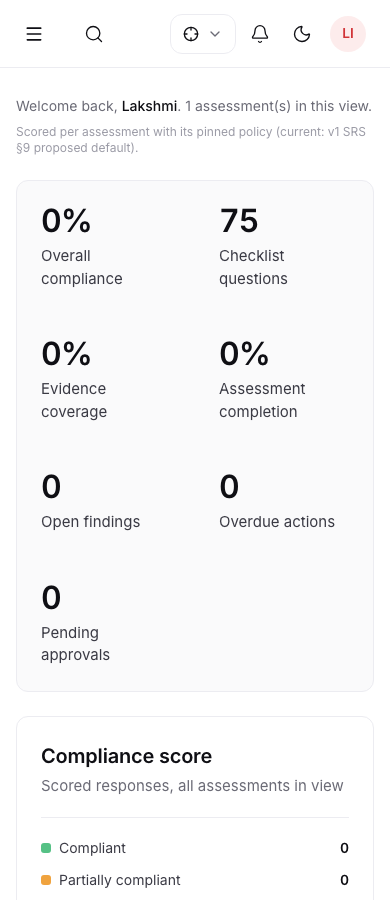

### Top bar

- **Breadcrumbs** show where you are; click a crumb to go back up.
- **Search** finds assessments, findings, evidence, checklists, questions and reports. Press ⌘K (Ctrl+K on Windows) from anywhere. On narrow screens it becomes a magnifier icon.
- **Scope** (the crosshair button, e.g. *All branches · All periods*) picks one branch and one assessment period. It applies to the dashboard and every list: assessments, findings, corrective actions, evidence, auditor work, My Assessments and reports. It turns purple when a scope is set.
- **Notifications** (bell) lists assignments, clarification requests, approvals and deadlines. Click one to jump to the record.
- **Theme** switches light and dark.
- **Account menu** (your name) shows your role, any restrictions an administrator set on you, *Profile & security* and *Sign out*.

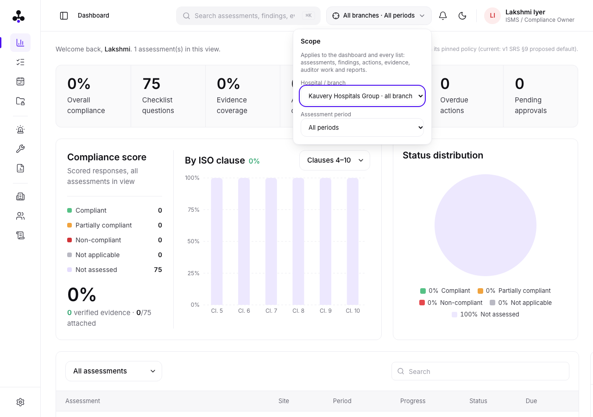

### Filters on list pages

- Each list has its own filters (search, status, severity, owner, overdue…).
- Active filters, including the top-bar scope, appear in a *Filtered by* row above the table. Click × on a chip to remove one, or *Clear all*.
- Filters are saved in the page address, for example `/findings?status=OPEN&site=…&period=Q3+FY2026-27`. Refresh, the Back button and a copied link all keep the same view.
- Export buttons on Findings and Corrective Actions download exactly the rows shown.

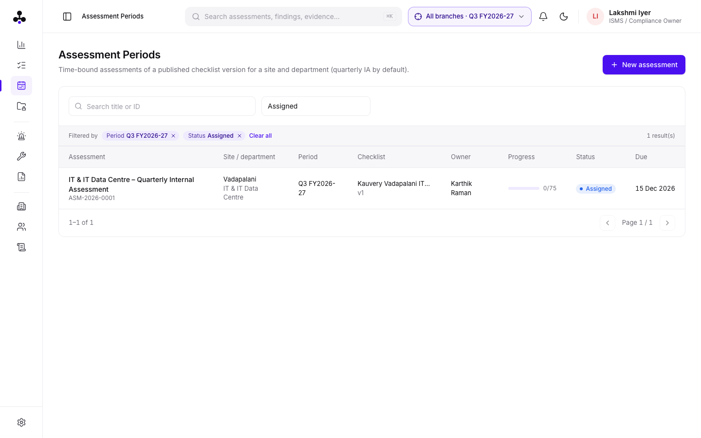

## The workflow at a glance

A full audit cycle runs in 12 steps across six roles. The system makes sure the person who prepares a step is never the one who checks or approves it: the checklist author never publishes, preparers never audit, and neither preparers nor auditors approve.

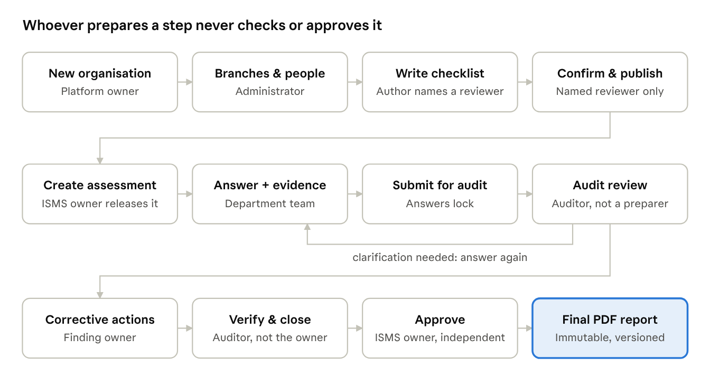

Read left to right, row by row. If the auditor asks for clarification, the department answers the flagged questions again and resubmits. Each step is explained in Tutorials 1 to 6 below.

## Tutorial 1 – Create a new organisation

A platform owner creates an organisation in five steps and can fill all of them from one Excel file. The result is a ready organisation with its own roles, branches, departments, users and default policies; every user gets a set-password e-mail.

**Who:** platform@axiarix.local. **Files:** `sample-org/01-organisation-setup.xlsx` and, optionally, `sample-org/02-checklist-internal-audit.xlsx`.

1. Sign in as the platform owner. You land on **Organisations**, which lists every organisation with its counts, administrators and status.
2. Click **New organisation**.
3. Click **Load setup workbook** and choose `01-organisation-setup.xlsx`. A message confirms *Loaded 3 branches, 5 departments and 14 users*. Any problems found in the file are listed in red at the top.
4. **Step 1 – Organisation:** check the name and legal entity.
5. **Step 2 – Branches & departments:** each branch needs a code (upper-case letters, digits, dashes) and a name. Each department belongs to a branch and can name an owner by e-mail.
6. **Step 3 – Users:** one row per role a person holds. Leave *Branch* as *Whole org* for organisation-wide access; pick a branch, and optionally a department, to limit it. *Restricted* takes permission keys such as `assessment:approve` to remove from that person only.
7. **Step 4 – Checklist (optional):** choose a checklist workbook. Every worksheet with a *Reports / Evidence Description* column becomes a draft checklist.
8. **Step 5 – Review & create:** the wizard checks everything with the server. Fix any listed problem (Back takes you to the step). Leave *E-mail every user a set-password link* on, then click **Create organisation**.
9. The confirmation shows how many users were created and invited, the first administrator, and the checklists imported as drafts.

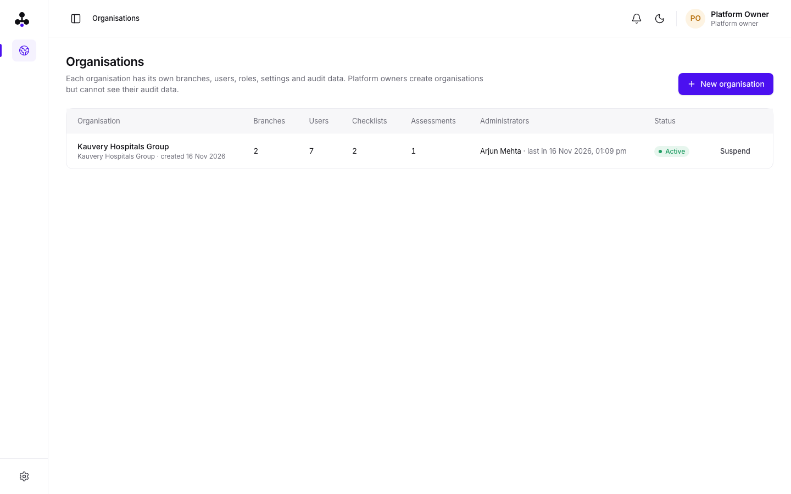

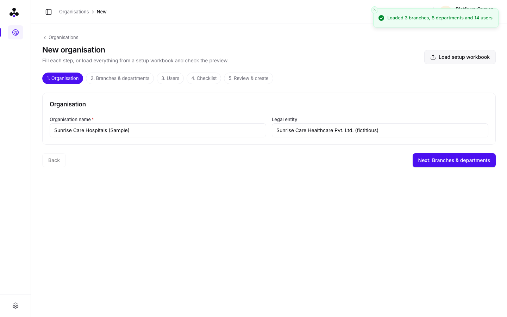

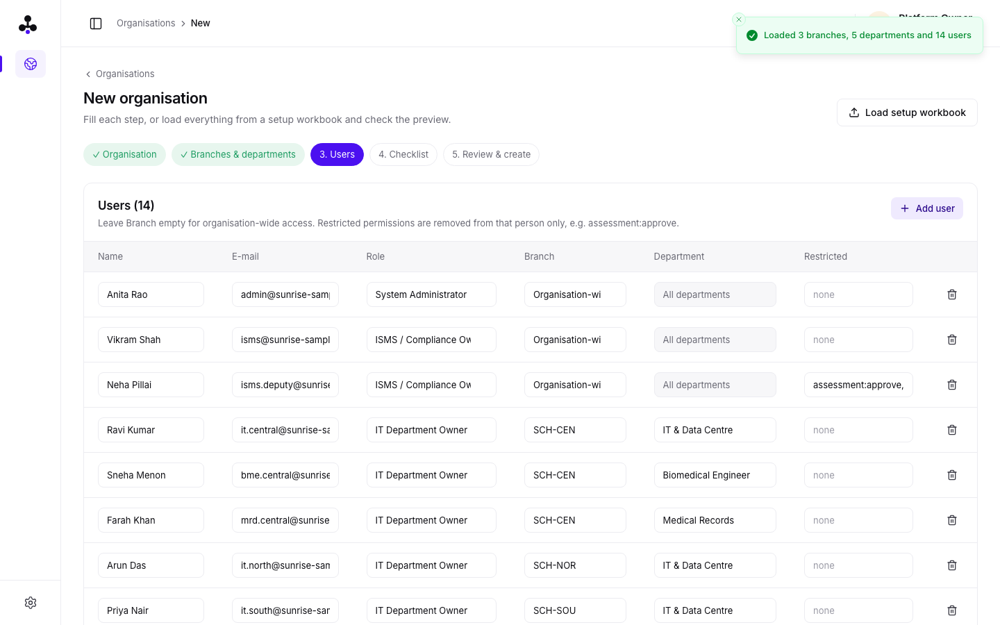

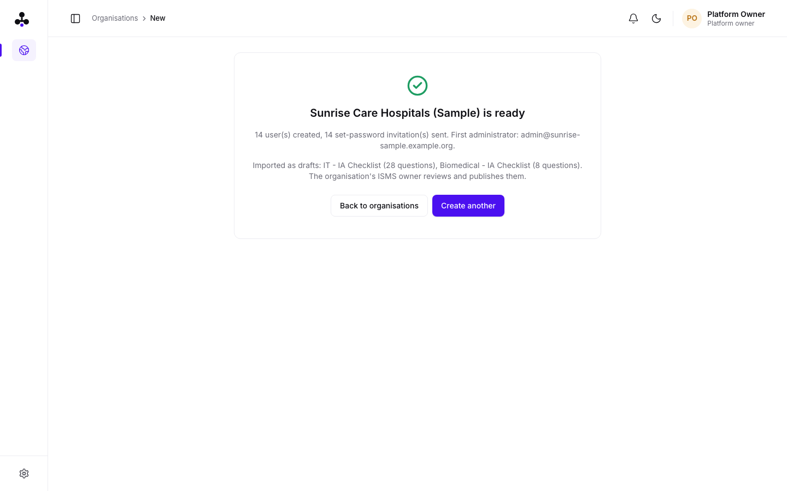

### What the server checks before creating

- The organisation name is new, branch codes and names are unique, and every department points at a real branch.
- Every user's branch and department exist, each e-mail is new to Axiarix and has one name, and every department owner is on the users list.
- There is at least one organisation-wide System Administrator.
- Every restricted permission is a real permission key.

### Setup workbook format

| Sheet | Columns |
| --- | --- |
| Organisation | Field · Value (Organisation name, Legal entity, …) |
| Branches | Branch code · Branch name · Address · Status |
| Departments | Branch code · Department name · Owner e-mail |
| Users | Full name · E-mail · Designation · Role key · Branch code (blank = org-wide) · Department · Restricted permissions |

Role keys: `SYSTEM_ADMIN`, `ISMS_OWNER`, `IT_OWNER`, `CONTRIBUTOR`, `AUDITOR`, `MANAGEMENT`.

### Suspending an organisation

On **Organisations**, click **Suspend** and give a reason. Everyone in it is signed out and cannot sign in until you click **Reactivate**. No data is deleted.

## Tutorial 2 – Set up the organisation as administrator

An administrator works through **Admin Home** top to bottom: branches, departments with owners, people, a published checklist, then the first assessment. A branch administrator sees and manages only their own branch.

**Who:** admin@axiarix.local (Kauvery) or admin@sunrise-sample.example.org (Sunrise).

### Admin Home

1. Click **Admin Home** in the sidebar. The *Setup* card shows each step as done (green tick) or open, with a warning when something is missing, e.g. *No auditor yet* or *1 ISO mapping still to resolve in drafts*.
2. Each row has a link to the page where you finish it. *People by role* counts active users per role.

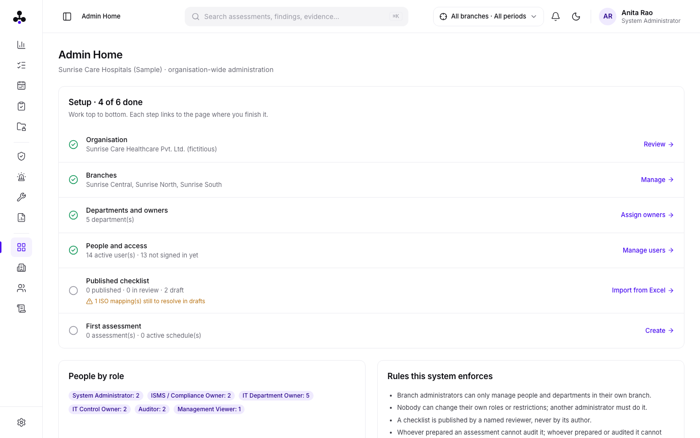

### Branches and departments

1. Open **Hospitals & Branches** and click **Add branch**. Enter a name and a code (upper-case letters, digits, dashes, e.g. `KVP`).
2. On the branch card, click **Department** to add one. Pick an owner: the IT Department Owner who will submit that department's assessments.
3. Use **Edit** on any branch or department to rename it, change the owner or mark it inactive.

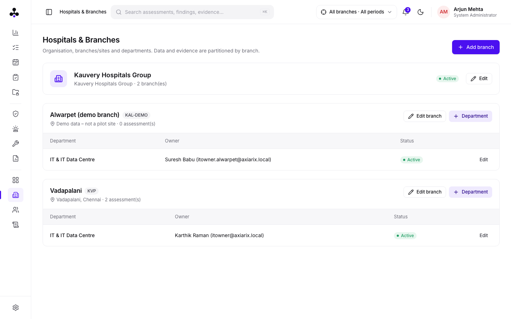

### People

1. Open **Users & Access Control** and click **Invite user**.
2. Enter name, e-mail and designation. Under *Roles & scope*, pick a role and, to limit it, a site and department. **Add role** gives the same person a second role.
3. Keep *E-mail a set-password link* on. The person receives an invitation (in Mailpit locally).
4. To change someone later, open the ⋯ menu on their row: **Edit details & roles**, **Restrict permissions**, or **Deactivate** (needs a reason; sessions end immediately).

The ⋯ menu only appears for people you are allowed to manage. Your own row shows *You*: nobody can change their own roles or restrictions.

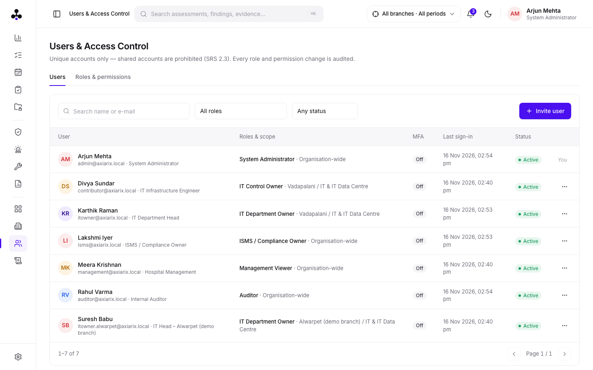

### Limit one person's power (restrict permissions)

Use this when one person should not do something their role normally allows, e.g. a trainee auditor who may review but not raise findings.

1. On **Users**, open the person's ⋯ menu and choose **Restrict permissions**.
2. The grid shows every permission their roles give them, ticked. A dot means the role doesn't include it.
3. Untick what to remove, e.g. Finding · Create. The cell turns red.
4. Optionally set *Restriction ends*; leave it empty to keep it until lifted.
5. Enter a reason (it is written to the audit trail) and click **Save restrictions**.

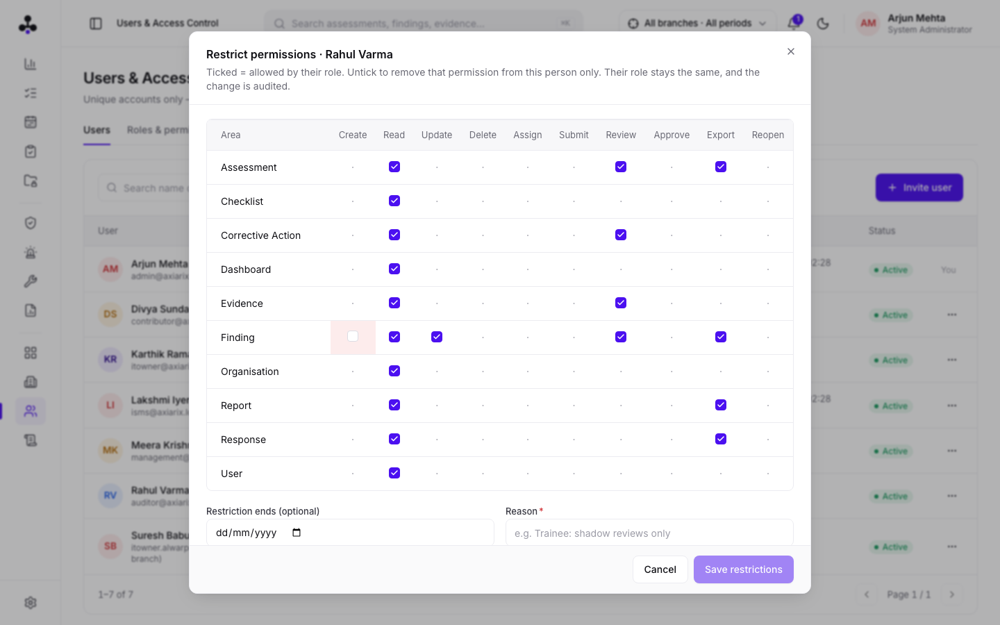

The user's row shows a *restricted* badge, and their account menu tells them how many permissions are restricted. The server refuses the removed actions everywhere, including through the API.

### Branch administrators

A System Administrator whose role is limited to one branch, such as branchadmin.north@sunrise-sample.example.org, can:

- add and edit departments in their branch;
- invite people into their branch and manage people who work only there.

They cannot add branches, edit the organisation, give anyone organisation-wide access, manage people in other branches, change role permissions, or change their own access. The API answers with a clear message when they try.

### Settings

Administrators see more tabs in **Settings**: *Workflow & uploads*, *Scoring*, *Retention*, *Notifications*, *Report configuration* and *Schedules*. Each organisation has its own settings, so Sunrise's report title does not change Kauvery's. Everyone else sees *Profile & security* and appearance only.

## Tutorial 3 – Build, review and publish a checklist

A checklist goes Draft → Under review → Published → Archived. The author submits it to a named reviewer, and only that reviewer can publish it, after every flagged ISO mapping is resolved and every review comment is closed. Published versions never change; edits make a new version.

**Who:** an ISMS owner writes (isms@axiarix.local); a different person with approval rights reviews (admin@axiarix.local).

### Import from Excel

1. Open **Checklist Library** and click **Import from Excel**.
2. **Upload workbook:** choose the `.xlsx` file (e.g. the Kauvery workbook or `sample-org/02-checklist-internal-audit.xlsx`).
3. **Worksheets & columns:** Axiarix finds the header row (*SL.NO, Reports / Evidence Description, Clauses, Controls (2022)…*) and maps each column. Adjust any mapping; only *Reports / Evidence Description* is required.
4. **Preview & validate:** every row shows its parsed question and ISO mappings. Rows with errors are excluded; warnings, such as an ambiguous reference, are flagged for review. **Error report** downloads the problems as Excel.
5. **Confirm import:** name each checklist and confirm. Each worksheet becomes a draft. Uploading the same file twice is detected and needs confirmation.

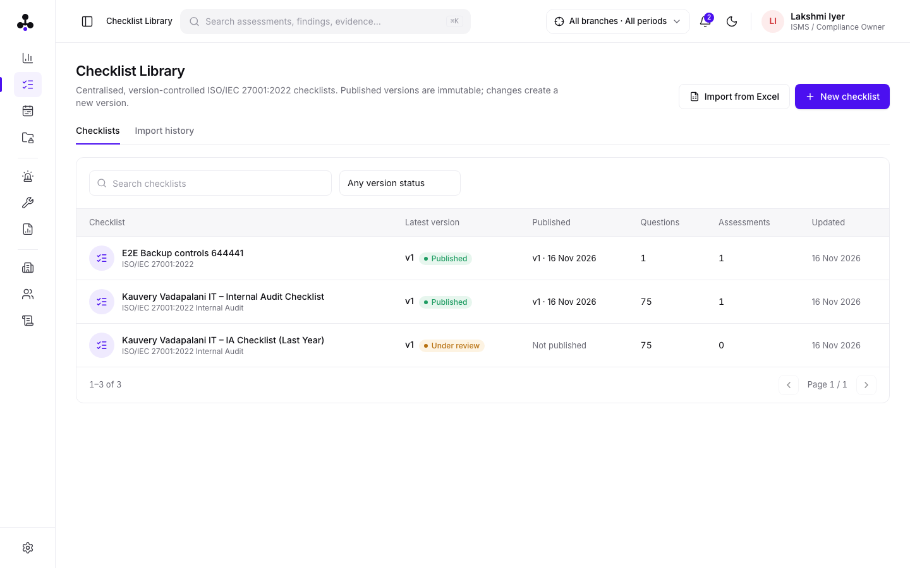

Or click **New checklist** to start empty and add questions by hand.

### Edit the draft

1. Open the checklist, then its version. Click **Add question**, or a question to edit it.
2. Set the question, description, guidance, evidence requirement, priority, default owner, and whether an answer and evidence are mandatory.
3. Under *ISO / control mapping*, add Annex A controls, ISO clauses, internal policies or risk references. Invalid references are refused.
4. Use the arrows to reorder questions, and the filters (search, priority, clause, *Show flagged only*) to find them.

### Submit for review

1. Click **Submit for review**.
2. Choose a **Reviewer**. The list shows ISMS owners and administrators, minus you and the author. The server also checks the reviewer can approve checklists.
3. Click **Submit**. Editing locks and the reviewer gets a notification.

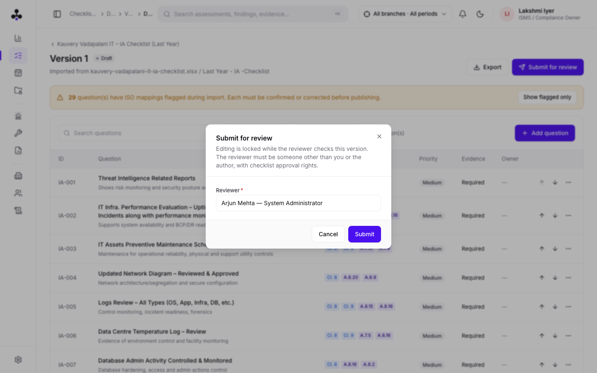

As the author you now see: *You wrote or submitted this version, so the named reviewer must publish or return it.* There is no Publish button for you.

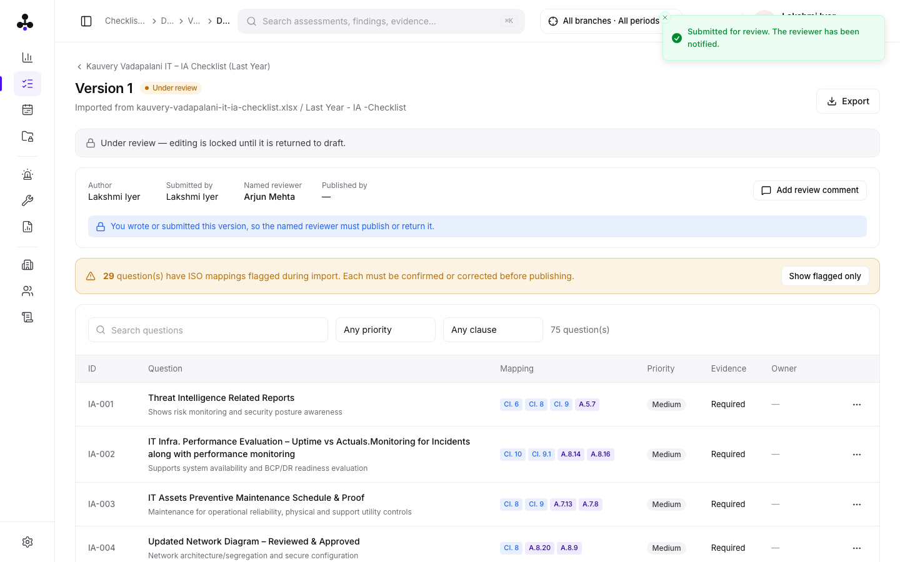

### Review as the named reviewer

1. Open the version from your notification. The review panel shows Author, Submitted by, Named reviewer and Published by.
2. **Flagged mappings:** an amber banner counts them. For each flagged question, check the mapping and click **Confirm as correct** under its chips (or the ⋯ menu). To change a mapping instead, return the version so the author corrects it.
3. **Comments:** **Add review comment** for the whole version, or ⋯ → **Comment on this question**. Comments list in the panel; anyone working on the version can **Resolve** them.
4. **Return with comments** sends it back to draft with a required summary; the author is notified.
5. **Publish** stays disabled until no flagged mapping and no open comment remains. Then click it and confirm. Any earlier published version of that checklist is archived automatically.

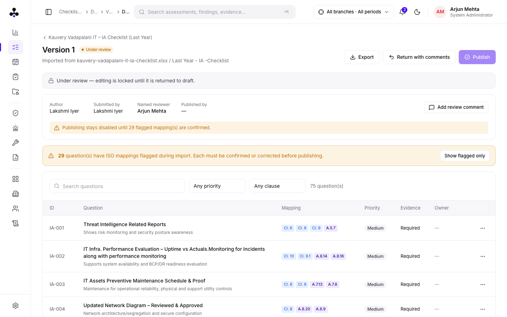

### New versions and archiving

On the checklist's page, create a new version from the current one with a change summary; it starts as a draft with all questions copied. Assessments keep the exact version they were created from. A published version can be **Archived** (with a reason) so new assessments can't use it.

## Tutorial 4 – Run an assessment

An assessment applies one published checklist version to one department for one period. The ISMS owner creates and releases it; the department answers every question, attaches evidence and submits it for audit, after which answers are locked.

**Who:** isms@axiarix.local creates; itowner@axiarix.local and contributor@axiarix.local answer.

### Create and release (ISMS owner)

1. Open **Assessment Periods** and click **New assessment**.
2. Enter a title, pick the **site**, the **department** and a **published checklist version**. The department's owner is filled in as the assessment owner.
3. Choose the **period** from the three pickers: *Period type* (Quarter, Half year or Financial year), the quarter or half, and the *Financial year*. The line below shows the label and dates, e.g. *Q3 FY2026-27 · 1 Oct 2026 – 31 Dec 2026*. Periods follow the Indian financial year (Q1 = Apr–Jun … Q4 = Jan–Mar); free text is not accepted.
4. Set the start and due dates, an optional scope statement, and whether a separate approval is required (on by default).
5. Click **Create assessment**. It starts as *Draft* with the checklist version and scoring policy pinned.
6. Click **Assign to department** to release it. The owner is notified and the status becomes *Assigned*.

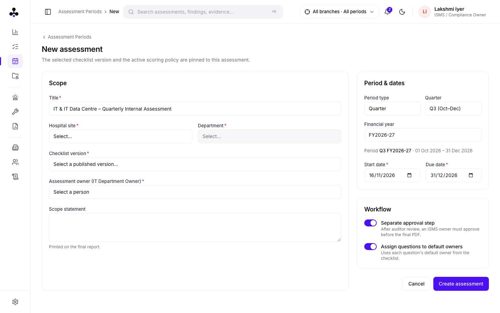

### Assign questions (department owner)

1. Open the assessment, tab **Questions & assignments**.
2. Tick questions and click **Assign** to give them to a contributor, with an optional due date. Contributors can only answer questions assigned to them; the department owner can answer any.

### Answer and attach evidence

1. Open **My Assessments** and click the assessment (or a question under *My open question assignments*). The workspace lists questions on the left and the selected question on the right.
2. Choose an answer: Compliant, Partially compliant, Non-compliant or Not applicable. Not applicable needs a justification. Add a comment and click **Save answer**. The first saved answer moves the assessment to *In progress*.
3. Click **Upload evidence** and drop a file (PDF, DOCX, XLSX, CSV, PNG, JPG; 25 MB by default). Each file is checksummed and malware-scanned; executables, disguised files and test viruses are refused.
4. Use **Add comment** to discuss a question with colleagues or the auditor.

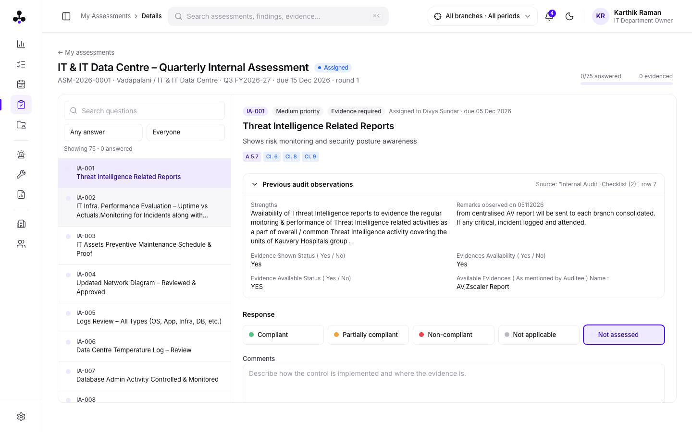

### Submit for audit

1. When every mandatory question has an answer and required evidence, click **Submit for audit**. If anything is missing, the dialog lists each gap; click one to jump to it.
2. Confirm with **Submit**. The status becomes *Submitted for audit* and the department's view becomes read-only.

Answers cannot change after submission. To correct one, an ISMS owner uses **Reopen** on the assessment with a reason; history, earlier submissions and issued reports are kept.

### Whoever prepares cannot audit

The assessment owner, everyone who answered a question and everyone who submitted it are its *preparers*. None of them can start or perform its audit review, even if they also hold the Auditor role or are administrators. They see a *Separation of duties* note explaining that another auditor must review it.

## Tutorial 5 – Audit review, findings and corrective actions

An independent auditor reviews every answer and evidence file, asks for clarification where needed, raises findings, and later verifies the department's corrective actions before closing each finding.

**Who:** auditor@axiarix.local reviews; itowner@axiarix.local and contributors respond and fix.

### Review the assessment

1. Open **Auditor Workspace**. The tiles count what is awaiting review, evidence to verify, clarifications out, open and critical/high findings, actions to verify and completed reviews. The *Review queue* lists submitted assessments.
2. Click an assessment, then **Start review**. The status becomes *Under review*.
3. For each question, check the answer and each evidence file (preview opens a 5-minute signed link). Then:
   - **Accept** the evidence or answer;
   - **Reject** evidence with a reason (the owner is notified and the file is marked rejected);
   - **Request clarification** with a reason, which reopens just that question for the department;
   - **Add comment** for a note without a decision.
4. Not applicable answers can be required to carry your explicit acceptance (Settings → *Workflow & uploads*).

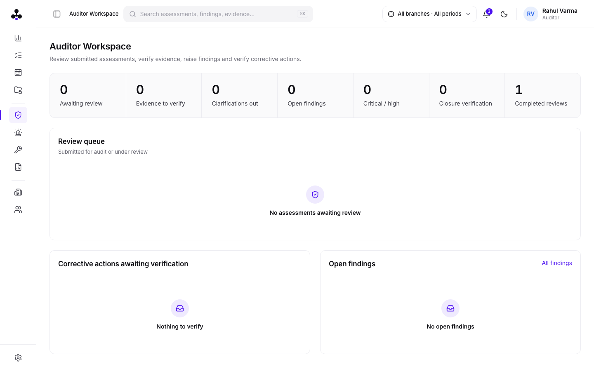

### Raise findings

1. On a question, click **Raise finding**; for the assessment as a whole use **Assessment-level finding**.
2. Pick category and severity (Low, Medium, High, Critical), write a title and description, set an owner and due date.
3. Findings appear on **Findings** with an ID such as FND-2026-0003.

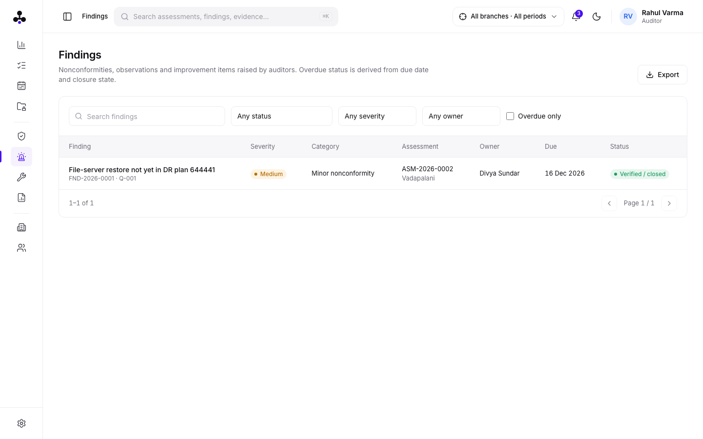

### Submit the review

Click **Submit review** and write your overall opinion.

- If any clarification is still open, the assessment goes to *Clarification required*. The department answers only the flagged questions and clicks **Submit for audit** again, and you review the new round.
- Otherwise it becomes *Reviewed*, and moves to *Pending approval* when approval is required.

### Corrective actions (department)

1. The finding owner opens the finding on **Findings** and clicks **Plan corrective action**: root cause, correction, corrective action, owner and target date.
2. On the action, **Update progress** records notes and a percentage.
3. **Upload** closure evidence, then **Submit for verification** with closure notes. At least one clean, non-rejected evidence file is required.

### Verify and close (auditor)

1. Open **Corrective Actions** or the *Corrective actions awaiting verification* list in the Auditor Workspace.
2. Click **Verify closure** to accept, or **Return** with a comment; returned actions go back to the owner and the finding back to *Action in progress*.
3. When all actions are verified, open the finding and click **Verify & close** with a closure recommendation.

The owner of an action, and anyone who submitted it for verification, cannot verify it. They see a *Separation of duties* note instead of the button.

## Tutorial 6 – Approval, final report, exports and dashboard

Approving a reviewed assessment generates its final PDF report automatically. Reports are versioned and cannot be edited; the dashboard and exports show live figures for the scope you pick.

**Who:** isms@axiarix.local approves; management@axiarix.local reads.

### Approve and issue the report

1. Open the assessment (status *Pending approval*) from **Assessment Periods** or the notification.
2. Click **Approve & issue report**, or **Reject** with a reason to send it back to *Under review*.
3. On approval the status becomes *Approved / closed*, the PDF is generated and stored, and the owner, auditors, ISMS owners and management are notified.
4. When no separate approval is configured, the reviewer or approver uses **Finalise & issue report** instead.

Whoever prepared or audited the assessment cannot approve or finalise it.

### Reports & Analytics

- Lists every final report with its version, branch and department, period, compliance %, evidence coverage and findings.
- The eye icon previews the PDF; the download icon saves it. Both use short-lived signed links and are logged.
- Tick *Include archived* to see superseded or deleted versions.
- *Data exports* download findings or corrective actions as XLSX or CSV for the current top-bar scope. Per-assessment answer exports are on each assessment's **Export** menu.

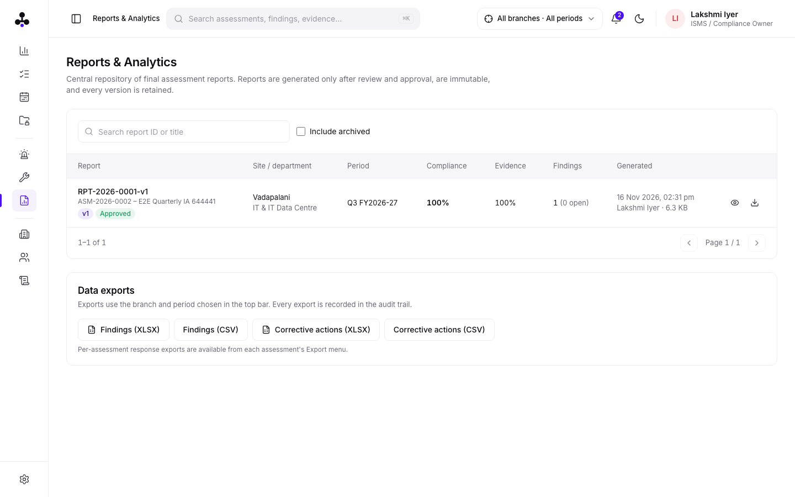

### Dashboard

- The KPI strip shows overall compliance, checklist questions, evidence coverage, assessment completion, open findings, overdue actions and pending approvals.
- *Compliance score* breaks answers into Compliant, Partially compliant, Non-compliant, Not applicable and Not assessed, scored with each assessment's pinned scoring policy (default: Partially = 0.5, N/A excluded, Not assessed = 0).
- *By ISO clause* shows compliance per clause (switch to Annex A themes); *Status distribution* shows the answer mix; a table lists assessments in scope with progress and status.
- Use the **Scope** button to see one branch or one period.

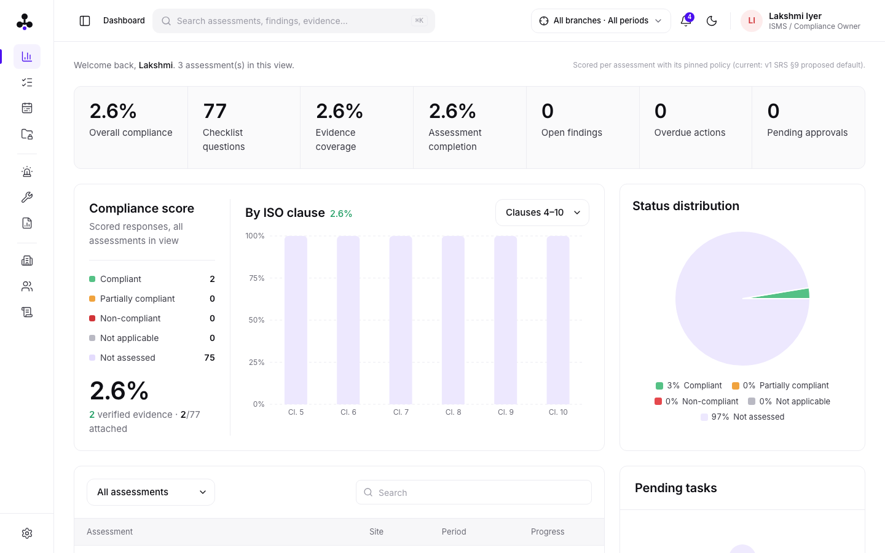

## Governance rules the system enforces

These rules are enforced by the server on every request, not just hidden in the screens. Breaking one returns a clear message, and a denied attempt is written to the audit trail.

| Rule | What happens | Who it protects against |
| --- | --- | --- |
| Separation of duties: checklists | The author or submitter cannot publish or return their own version; only the named reviewer can. | Self-approved checklists |
| Separation of duties: assessments | Owner, anyone who answered and anyone who submitted cannot audit. They and the auditors cannot approve or finalise. | Marking your own homework |
| Separation of duties: corrective actions | The action owner, or whoever submitted it, cannot verify it. | Self-closed findings |
| No self-service access | Nobody can change their own roles or restrictions. | Privilege escalation |
| Branch-scoped administration | A branch administrator manages only their branch; organisation-level changes need an organisation-wide administrator. | Admins overreaching their branch |
| Per-user restrictions | A removed permission is refused everywhere for that person, until lifted or its end date passes. | One person needing less power than their role |
| Organisation isolation | Users, roles, settings and data never cross organisations; the platform owner sees none of it. | Data leaking between hospitals |
| Branch data partitioning | Users only see records of their branch or department scope; a cross-branch attempt is denied and logged. | Branch data mixing |
| Immutable published checklists | Questions and mappings of a published or archived version cannot be changed, also at database level. | Silent changes to the audit basis |
| Locked submissions | Answers can't change after submission without a formal **Reopen** with a reason. | Editing answers after review starts |
| Immutable reports | Issued reports cannot be edited; deletion goes through a two-step secure deletion request. | Altered evidence of approval |
| Fixed periods | Only `Q1–Q4 FYyyyy-yy`, `H1/H2 FYyyyy-yy`, `FYyyyy-yy` (Indian financial year) are accepted; dates come from the label. | Mismatched or mistyped periods |
| Evidence safety | Files are type-checked, checksummed, versioned and malware-scanned; only clean files can be accepted. | Malicious or tampered files |
| Audit trail | Security and business actions are written to an append-only, hash-chained log; *Verify* checks the chain. | Untraceable changes |

Where a rule blocks you, the page shows a blue *Separation of duties* note or an explanatory message instead of the button.

## Feature reference

Every page in the app, what it is for, who sees it and its main actions. Screenshots of the key screens follow the table.

| Page | Address | Who sees it | What you can do |
| --- | --- | --- | --- |
| Sign in | `/login` | Everyone | Sign in, *Forgot password?*, two-step code when MFA is enabled |
| Organisations | `/platform` | Platform owner | List organisations with counts and admins, Suspend / Reactivate |
| New organisation | `/platform/new` | Platform owner | 5-step wizard, load setup workbook, import checklists, send invitations |
| Dashboard | `/` | Anyone with dashboard access | KPIs, compliance score, by clause / Annex A theme, status mix, assessments in scope |
| Checklist Library | `/checklists` | Checklist readers | Search, status filter (current version), **New checklist**, **Import from Excel**, *Import history* tab |
| Import from Excel | `/checklists/import` | Checklist creators | Upload, map columns, preview and validate, error report, confirm |
| Checklist version | `/checklists/:id/versions/:v` | Checklist readers | Edit questions and mappings (draft), submit to reviewer, comments, confirm mappings, publish, archive, export |
| Assessment Periods | `/assessments` | Assessment readers | List with status filter and scope, **New assessment** |
| New assessment | `/assessments/new` | Assessment creators | Site, department, checklist version, period picker, dates, owner, approval |
| Assessment | `/assessments/:id` | Assessment readers | Overview, Questions & assignments, History; release, assign, approve / reject, finalise, reopen, export |
| My Assessments | `/my-assessments` | Responders | Your assessments and open question assignments |
| Workspace | `/my-assessments/:id` | Responders | Answer, comment, upload evidence, submit for audit |
| Evidence Repository | `/evidence` | Evidence readers | Search, verification / link / classification filters, preview, download, new version, rescan, request deletion |
| Auditor Workspace | `/auditor` | Auditors | Tiles, review queue, actions to verify, open findings, clarifications |
| Audit review | `/auditor/:id` | Auditors | Start review, accept / reject / clarify, raise findings, submit review |
| Findings | `/findings` | Finding readers | Filters (status, severity, owner, overdue), export rows shown |
| Finding | `/findings/:id` | Finding readers | Assign owner, plan corrective action, comment, verify & close |
| Corrective Actions | `/corrective-actions` | Action readers | Filters, export rows shown |
| Corrective action | `/corrective-actions/:id` | Action readers | Edit plan, update progress, upload, submit for verification, verify / return |
| Reports & Analytics | `/reports` | Report readers | Final PDFs (view, download), include archived, data exports |
| Admin Home | `/admin` | Administrators | Setup checklist, people by role, rules summary |
| Hospitals & Branches | `/organisation` | Organisation readers | Add / edit branches and departments, owners |
| Users & Access Control | `/users` | User readers | Invite, edit roles and scope, restrict permissions, deactivate; *Roles & permissions* tab |
| Audit Trail | `/audit-trail` | Audit-log readers | Search and filter events, verify hash chain, export |
| Settings | `/settings` | Everyone | Profile, password, MFA, appearance; admins also workflow, scoring, retention, notifications, report configuration, schedules |

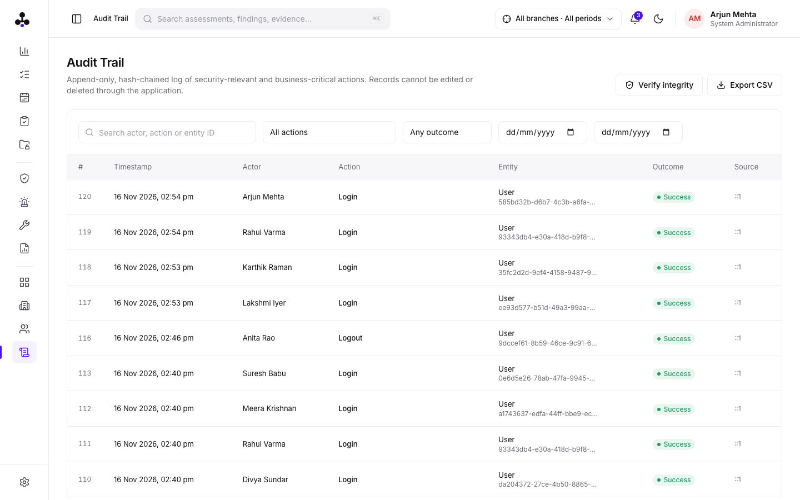

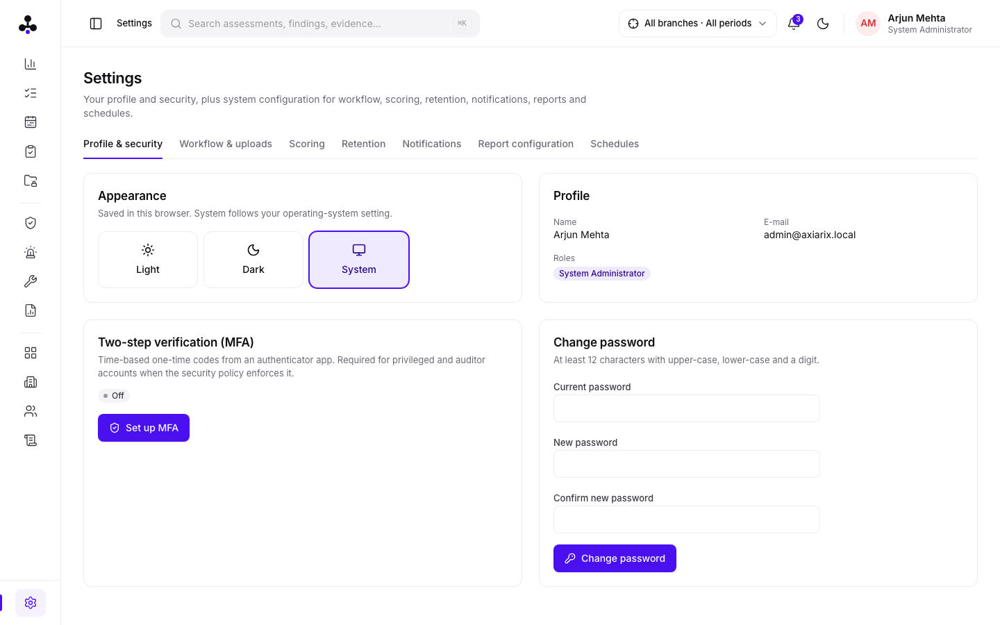

## Troubleshooting and FAQ

| You see | Why | What to do |
| --- | --- | --- |
| *Invalid e-mail or password* | Wrong password, or the account has no password yet | Check the password; invited users set one from their Mailpit e-mail or *Forgot password?* |
| *Account temporarily locked* | 5 wrong passwords in a row | Wait 15 minutes |
| *You don't have access to this page* | Your role or a restriction doesn't allow it | Ask an administrator for the role, or to lift the restriction |
| No ⋯ menu on a user | That person is outside your branch, or it's you | An organisation-wide administrator (or another admin) must do it |
| *Separation of duties* note, no Start review / Approve / Verify / Publish button | You prepared, audited, own or submitted that record | Someone else with the role must do this step |
| Publish is greyed out | Flagged ISO mappings or open review comments remain | Confirm or correct each flagged mapping; resolve or return the comments |
| *Choose a reviewer* / reviewer refused | No reviewer picked, or the person can't approve checklists | Pick an ISMS owner or administrator other than yourself and the author |
| *N question(s) are incomplete* | Mandatory answers or evidence missing | Click each listed question in the dialog, fix it, submit again |
| *This assessment has been submitted and is read-only* | Answers lock after submission | Ask an ISMS owner to **Reopen** it with a reason |
| Upload refused | Wrong type, over the size limit, disguised or flagged as malware | Upload a clean PDF, DOCX, XLSX, CSV, PNG or JPG under the limit |
| *Use a period such as "Q3 FY2026-27"* | Period not in a fixed format | Use the period pickers on New assessment |
| A list looks empty | A top-bar scope or a page filter is active | Look at the *Filtered by* row and click *Clear all* |
| Invitation link doesn't work | Links expire after 30 minutes | Use *Forgot password?* to send a fresh one |
| *Organisations are created by a platform owner* | Organisation admins can't create organisations | Sign in as the platform owner |

**Why can't the admin do everything?** By design, the System Administrator holds every permission but still can't publish a checklist they wrote, audit an assessment they prepared, approve one they prepared or audited, or change their own access. This keeps the audit evidence independent (ISO/IEC 27001 A.5.3).

**Does restricting someone change their role?** No. The role stays the same for everyone else; only that person loses the chosen permissions.

## Release notes – 16 November 2026

| Area | Change |
| --- | --- |
| Organisations | Several organisations per installation; platform owner with a 5-step wizard and Excel setup; suspend / reactivate |
| Access | Branch-scoped administrators; nobody changes their own access; per-user permission restrictions with reason and end date |
| Separation of duties | Named checklist reviewer; preparers cannot audit; preparers and auditors cannot approve; action owners cannot verify |
| Checklist review | Review comments per question; flagged mappings confirmed one by one before publishing |
| Periods | Fixed Indian financial-year labels picked from lists; dates derived |
| Navigation | Scope button at every width, collapsible search, grouped sidebar matching each role's access, Admin Home |
| Filters | Branch and period apply to every list; filters kept in the page link; *Filtered by* chips; exports match the rows shown; checklist status filter uses the current version |
| Fixes | Settings no longer errors for non-admins; the Dashboard, Users roles grid and detail pages no longer scroll sideways on narrow screens; period pickers no longer cut off their labels |
| Quality | 62 backend, 11 frontend and 2 browser tests pass; a page-by-page check of 11 accounts on desktop and phone found no errors |

## Onboarding run: Meridian Diagnostics (Sample)

On 16 November 2026 a new organisation, Meridian Diagnostics (Sample), was created through the wizard in Chrome from `sample-files/01-organisation-setup/meridian-diagnostics-organisation-setup.xlsx`. All 9 users accepted their e-mail invitation, set a password and were signed in at the same time, each in its own Chrome tab. A page-by-page check of all 9 accounts found no remaining errors. 5 bugs were found during the run and fixed.

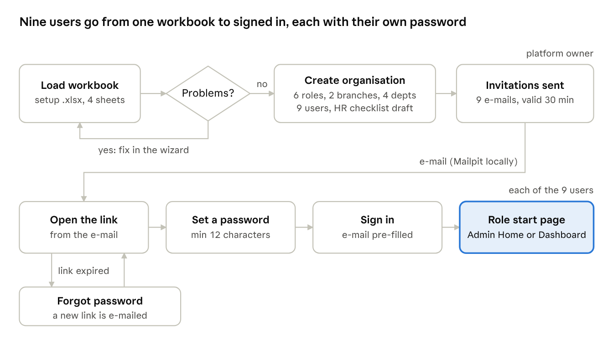

The platform owner's part runs once; the lower row runs for each of the nine people. Nobody is given a password: each person chooses their own from the invitation.

### Meridian logins

Password for all nine: `Meridian@Demo2026` (development only). Each person has a separate address so that all nine can stay signed in in one Chrome window; plain http://localhost:5174 also works for any one of them.

| Name | Login ID | Role | Scope | Restricted | Chrome address |
| --- | --- | --- | --- | --- | --- |
| Rohan Mehra | admin@meridian-sample.example.org | System Administrator | Whole organisation | — | http://rohan.meridian.localhost:5174 |
| Ishita Kapoor | isms@meridian-sample.example.org | ISMS / Compliance Owner | Whole organisation | — | http://ishita.meridian.localhost:5174 |
| Nikhil Rao | it.hq@meridian-sample.example.org | IT Department Owner | Meridian Head Office (MDX-HQ) / IT & Infrastructure | — | http://nikhil.meridian.localhost:5174 |
| Pooja Shetty | fin.hq@meridian-sample.example.org | IT Department Owner | MDX-HQ / Finance Systems | — | http://pooja.meridian.localhost:5174 |
| Arvind Iyer | lis.lab@meridian-sample.example.org | IT Department Owner | Meridian Central Lab (MDX-LAB) / Laboratory Information Systems | — | http://arvind.meridian.localhost:5174 |
| Sana Qureshi | it.lab@meridian-sample.example.org | IT Department Owner | MDX-LAB / Lab IT Support | — | http://sana.meridian.localhost:5174 |
| Tarun Bhat | engineer.lab@meridian-sample.example.org | IT Control Owner / Contributor | MDX-LAB / Lab IT Support | Cannot upload evidence | http://tarun.meridian.localhost:5174 |
| Gita Menon | auditor@meridian-sample.example.org | Auditor | Whole organisation | — | http://gita.meridian.localhost:5174 |
| Dr. Vivek Shah | md@meridian-sample.example.org | Management Viewer | Whole organisation | — | http://vivek.meridian.localhost:5174 |

Platform owner for this run: platform@axiarix.local / `Axiarix@Dev2026` at http://platform.localhost:5174.

### Bugs found and fixed

| # | Found when | Severity | Problem | Fix | Verified |
| --- | --- | --- | --- | --- | --- |
| 1 | Users signing in | High | If the server restarted or the network dropped for a second while a page loaded, a signed-in user was sent to the sign-in page even though their session was still valid. 8 of the 9 Meridian tabs were signed out this way. | Session restore now retries for up to about 7 seconds on a server or network error; only a definite "no session" answer signs the user out. | Browser test with 2 blocked restore attempts: user stays signed in |
| 2 | Wizard steps 2 and 3 | Low | Boxes were too narrow, so branch names, e-mails and "Whole org" were cut off. | Each column has a minimum width; the table scrolls sideways inside its card. | Screenshot of the Users step |
| 3 | Accepting an invitation | Low | After setting a password, the sign-in form was empty, so people had to retype their e-mail. | The e-mail is carried to the sign-in form (kept out of the address bar). | Browser test: field pre-filled, address bar has no e-mail |
| 4 | New organisation dashboard | Low | With no answers yet, *Status distribution* drew a solid circle that looked like data. | Shows a dashed ring with "No answers yet". | Seen in Ishita's tab |
| 5 | Sign-in page | Low | The page said "Hospital IT pilot" for every organisation, including a diagnostics company. | Now reads "ISO/IEC 27001:2022 compliance management". | Code change |

Checked and not a bug: the "test pvt" organisation's administrator is shown as Anita Rao because that is the name entered for admin@test.com.

Tarun's restriction was checked against the server: his account has no `evidence:create` permission and an evidence upload is refused (403).

## Appendix: sample files and running locally

### Sample organisation files (`axiarix_demo/sample-org/`)

| File | Contents |
| --- | --- |
| `01-organisation-setup.xlsx` | Organisation, 3 branches (SCH-CEN, SCH-NOR, SCH-SOU), 5 departments, 14 users with roles, scope and restrictions |
| `02-checklist-internal-audit.xlsx` | Two checklist sheets in the Kauvery layout: IT – IA Checklist (28 questions) and Biomedical – IA Checklist (8 questions). Question 4 is flagged on purpose to exercise mapping review |
| `README.md` | What each file is for and what it tests |

### Running locally on this machine

Ports differ from the project README because 5433 and 5173 are used by another project here.

| Service | Port | How it runs |
| --- | --- | --- |
| PostgreSQL | 5434 | Docker `axiarix-postgres-1` (compose override maps 5434 → 5432) |
| API | 5050 | `npm run dev` in `backend`, with `DATABASE_URL=…@localhost:5434/axiarix` and `FRONTEND_ORIGIN=http://localhost:5174` |
| Web app | 5174 | `npx vite --port 5174 --strictPort` in `frontend` |
| MinIO (files) | 9002 / console 9003 | Docker |
| Mailpit (e-mail) | 1025 / inbox 8025 | Docker |

### Tests

| Suite | Command | Result on 16 Nov 2026 |
| --- | --- | --- |
| Backend unit + integration | `npx vitest run` in `backend` (with `TEST_DATABASE_URL` on port 5434) | 62 passed |
| Frontend unit | `npx vitest run` in `frontend` | 11 passed |
| End-to-end (browser) | `E2E_BASE_URL=http://localhost:5174 npx playwright test` in `frontend` | 2 passed |

### Demo video and screenshots

- **Feature tour video (2 min 16 s, captioned):** `docs/demo/axiarix-feature-tour.mp4` (also `.webm`). It walks through the platform wizard, Admin Home, restricting a user, the Scope button and filters, the checklist reviewer flow, the period picker, the workspace, the auditor workspace, findings, reports, audit trail and settings.
- **Re-record it:** `node docs/demo/record-tour.mjs <output folder>` while the app runs on port 5174.
- **Screenshots used in this guide:** `docs/screenshots/guide/` (24 images).

### Resetting the demo data

`npx prisma migrate reset --force` then `npm run db:seed` in `backend`, with `DATABASE_URL` pointing at port 5434. This deletes all development data, including Sunrise Care, and re-creates the Kauvery demo and the platform owner. Never run it against a production database.
